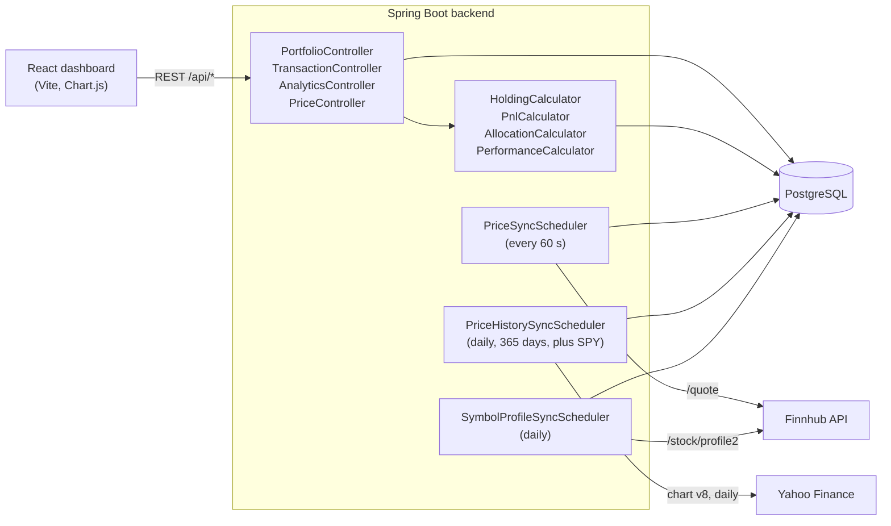

# Stock Portfolio Tracker

A personal stock portfolio tracker: record buy and sell transactions, see holdings valued at Finnhub prices, and compare the portfolio against SPY.

## Demo

No hosted demo. It runs locally with Docker Compose (see below).

<!-- SCREENSHOT: dashboard with a portfolio selected, showing holdings table, P&L breakdown, sector allocation chart and performance-vs-SPY chart. Save as docs/screenshot.png -->

## What it does

- Create portfolios and record BUY and SELL transactions (symbol, quantity, price, execution time). Transactions can be deleted.
- Derives holdings from the transaction history, with average cost basis, current price, market value and unrealized P&L per position.
- Reports realized and unrealized P&L for a portfolio.
- Shows sector allocation by market value, using the industry Finnhub returns for each symbol (`Unknown` when it has none).
- Charts portfolio percent change against SPY over the cached daily price history.
- Polls Finnhub for the latest quote of every traded symbol once a minute, and refreshes a year of daily closes (from Yahoo Finance) and the sector profile (from Finnhub) once a day.

## Architecture



Requests never call Finnhub or Yahoo directly. Three schedulers write quotes (`PriceSnapshot`), daily closes (`PriceHistory`) and sectors (`SymbolProfile`) to Postgres, and the API reads only from the database, so a slow or failing price API does not block a page load; the cost is that prices are up to a minute old. Holdings are not stored: `HoldingCalculator` replays the transaction list each time and uses average cost basis, so a SELL realizes `(sell price - average cost) x quantity`. The calculators are pure static functions that take transactions and price lookups and do no I/O, which keeps them unit-testable without a database. `PerformanceCalculator` uses SPY's dates as the trading-day timeline, carries each symbol's last close forward over gaps, and starts both series at 0% on the portfolio's first funded day; it is a price-curve comparison, not a cash-flow-adjusted return. The schema is managed by Hibernate (`ddl-auto: update`), with no migration tool.

## Stack

- Backend: Java 21, Spring Boot 3.3 (web, data JPA, validation), PostgreSQL driver, Lombok
- Frontend: React 19, TypeScript, Vite, Tailwind CSS 3, Chart.js with react-chartjs-2
- Data: PostgreSQL 16 (Docker Compose), Finnhub REST API for quotes and company profiles, Yahoo Finance chart endpoint for daily closes
- Tests: JUnit 5, Spring Boot Test, Testcontainers (PostgreSQL), Vitest

## Run it locally

Requires Docker. A Finnhub API key is needed for real quotes and sectors; without one the backend falls back to the key `demo`. Daily closes come from Yahoo Finance's unofficial chart endpoint, which needs no key but can change without notice; Finnhub's `/stock/candle` is not available on free keys.

```bash
export FINNHUB_API_KEY=your_key
docker compose up --build
```

- Frontend: http://localhost:5173
- Backend: http://localhost:8080

Without Docker for the app itself (needs JDK 21, Maven and Node.js; the repo has no Maven wrapper):

```bash
docker compose up -d postgres

cd backend
FINNHUB_API_KEY=your_key mvn spring-boot:run

cd ../frontend
npm install
npm run dev
```

The frontend reads the backend URL from `VITE_API_URL` and defaults to `http://localhost:8080`. The backend only allows CORS from `http://localhost:5173`.

## Tests

```bash
cd backend && mvn test          # Docker must be running for the Testcontainers tests
cd frontend && npx vitest run
```

Counts, taken from the source rather than a test run: the backend has 102 test methods (100 `@Test` plus 2 `@ParameterizedTest` with 9 cases between them, so 109 executions) across 25 test classes, 9 of which start a PostgreSQL container. The frontend has 6 Vitest tests in 2 files. Counted with `grep -E '^\s*@Test\s*$'`, `grep '@ParameterizedTest'` and `grep -E '^\s*(it|test)\('`.

Schedulers are disabled in tests with `finnhub.scheduling-enabled: false`.

## Project layout

```
backend/            Spring Boot API, schedulers and Finnhub clients
  src/main/java/com/portfoliotracker/
    portfolio/      portfolios and the holdings endpoint
    transaction/    BUY/SELL transactions
    holding/        holdings derived from transactions
    analytics/      P&L, sector allocation, performance vs SPY
    price/          latest quotes and the 60 s poller
    pricehistory/   daily closes and the daily sync
    symbolprofile/  sector data and the daily sync
frontend/           React dashboard (Vite, Tailwind, Chart.js)
docker-compose.yml  postgres, backend and frontend services
```
